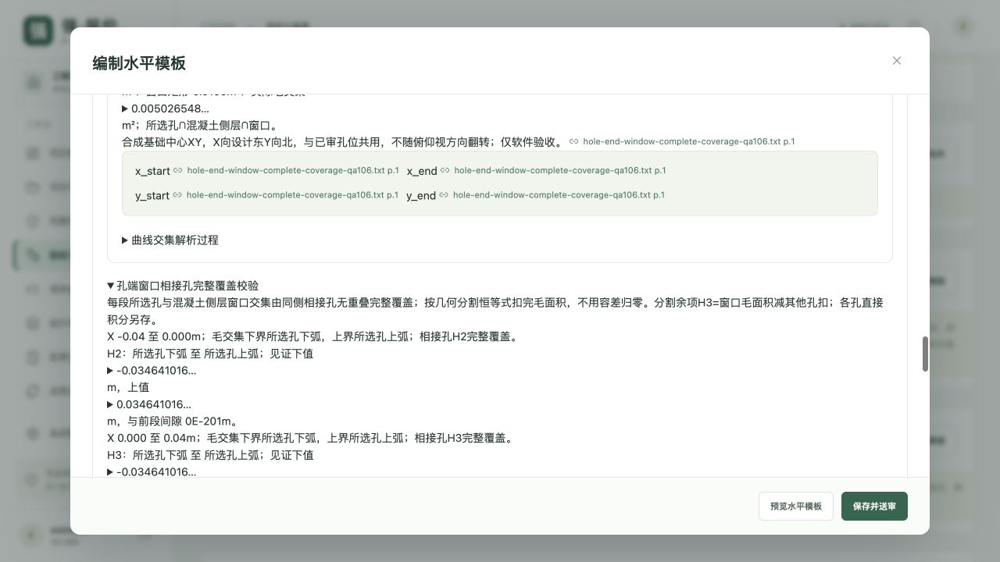
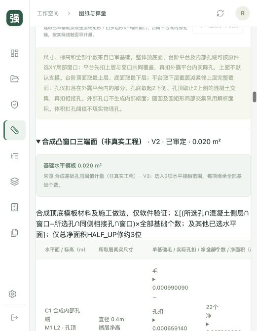
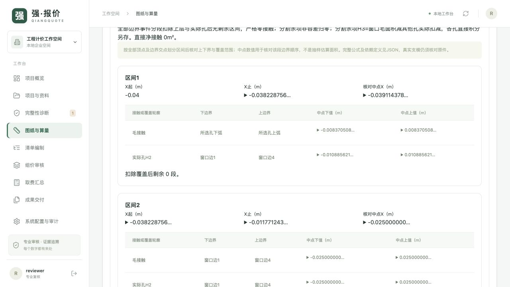

# 强·报价详细使用手册

适用版本：0.109.0

最后更新：2026-10-27

适用对象：项目负责人、造价编制人员、专业复核人员、企业管理员及本地部署维护人员。

本手册说明当前已经实现的操作。项目定位为受控工程工作台，尚未完成 PRD 全量商业验收。文中的数学示例和截图属于隔离合成数据，不能作为真实工程尺寸、定额、价格或专业判断依据。

后续版本继续维护本文件，不另建一份互相冲突的“最新版手册”。每次新增、修改、停用功能，应同时更新对应章节、适用版本、更新日期和末尾的维护记录。具体要求见[文档维护约定](#maintenance)。

## 目录

1. [先了解工作方式](#orientation)
2. [安装、启动与登录](#startup)
3. [账号、角色与项目访问](#accounts)
4. [页面导航与状态](#navigation)
5. [第一次完成一个项目](#first-project)
6. [新建项目、范围与计价日期](#project)
7. [上传资料与文件版本](#documents)
8. [证据定位、扫描识别与人工抄录](#evidence)
9. [事实候选、图纸目录与跨图互参](#drawings)
10. [资料完整性与补件任务](#completeness)
11. [算量通用流程及九类基础几何](#takeoff)
12. [分项、区域、多边形与逐面计量](#regions)
13. [设计管线与 DXF 坐标采用](#routes)
14. [沟槽、垫层、井筒、井板与回填](#civil)
15. [栏杆、立柱、材料及备料下料](#railing)
16. [立柱基础、孔洞与模板](#foundations)
17. [黄金底稿对账与差异诊断](#baseline)
18. [清单编制、导入、拆并和编码映射](#boq)
19. [定额、资源、供应商报价与调价](#pricing)
20. [工程层级、取费与报价快照](#fees)
21. [独立复核、批量复核与失效处理](#review)
22. [变更签证、版本对账与结算差异](#changes)
23. [成果预览、导出、留档及校验](#delivery)
24. [模型与独立密钥服务配置](#model)
25. [专业软件往返验证台账](#integration)
26. [备份、恢复、迁移与日常维护](#operations)
27. [常见问题](#faq)
28. [交付检查清单与当前边界](#checklist)
29. [后续功能与文档同步维护](#maintenance)

<a id="orientation"></a>
## 1. 先了解工作方式

系统按下列顺序推进：

**原始资料 → 来源证据 → 事实和尺寸 → 构件 → 工程量计算书 → 清单 → 定额及资源价格 → 取费规则 → 报价快照 → 成果审核和交付。**

编制人员录入和修订，独立复核人员核对原件后审定。识别成功、计算成功、保存成功和专业审定是不同的状态；模型或 OCR 的输出只提供候选，不能直接变成已审工程量或报价。

使用中牢记以下规则：

- 每个关键尺寸、材料做法、计量口径、扣减、定额、价格和取费规则，都应关联当前项目的有效原始依据。
- 屏幕示意只用于定位。禁止按示意比例、PDF 像素或 CAD 投影的显示距离填写施工尺寸。
- 工程量单位、原始尺寸单位、重复数量和定额消耗单位必须分别核对；不要重复换算或重复乘数量。
- 原件或上游数据变更后，下游审核可能失效。应从最先变化的环节重新核对，再重新计算、复核和导出。
- 历史报价和历史导出件保留原样。历史文件上的“已审”描述生成当时的状态，不代表当前项目仍可直接采用。
- 缺资料、缺价格或未审数据可以形成有明确标记的草稿，不能靠填零、编造编码或关闭检查代替补齐依据。

<a id="startup"></a>
## 2. 安装、启动与登录

### 2.1 已安装环境启动

部署要求为 Python 3.12+、Node.js 22+、pnpm 11。以下命令均在项目根目录执行：

```sh
.venv/bin/python scripts/build.py
.venv/bin/python scripts/start.py
```

打开 [工作台](http://127.0.0.1:8000/)。默认只监听本机；关闭启动进程会停止服务。若端口已有服务，先确认现有服务版本和用途，不要反复启动多个进程。

### 2.2 全新环境安装

```sh
python3 -m venv .venv
.venv/bin/pip install -r requirements.lock.txt
cd frontend
pnpm install --frozen-lockfile
cd ..
.venv/bin/python scripts/build.py
.venv/bin/python scripts/start.py
```

命令行需要由部署维护人员执行。日常编制人员在服务运行后直接打开浏览器登录即可。

### 2.3 首次登录

首次初始化数据库时，服务终端显示随机初始化密码。初始账号如下：

| 账号 | 身份 | 用途 |
|---|---|---|
| `admin` | 企业管理员 | 建立成员、分配角色及项目访问管理，也可参与编制 |
| `estimator` | 造价编制 | 资料整理、构件算量、清单组价与成果编制 |
| `reviewer` | 专业复核 | 独立核对证据、工程量、规则和成果 |
| `other` | 另一测试企业账号 | 验证企业隔离，不用于当前企业的实际协作 |

本地首次初始化的账号使用同一初始化密码；实际协作前分别设置密码。系统没有公开注册入口。

忘记密码时，由本机维护人员执行，按提示输入至少 12 位的新密码，输入不回显：

```sh
.venv/bin/python scripts/manage.py reset-password admin
.venv/bin/python scripts/manage.py reset-password estimator
.venv/bin/python scripts/manage.py reset-password reviewer
```

重置后该账号旧会话全部注销。不要把实际密码写进手册、项目文件或 Git 仓库。

### 2.4 常用运行配置

程序读取环境变量，**不会自动加载 `.env` 文件**。`.env.example` 是变量清单，复制为 `.env` 并不等于配置生效。

| 配置 | 作用及使用注意 |
|---|---|
| `QIANG_HOST` | 默认 `127.0.0.1`，决定监听地址 |
| `QIANG_PORT` | 默认 `8000`，决定访问端口 |
| `QIANG_DATA_DIR` | 默认 `data`，保存数据库、原件及导出件；建议部署时使用绝对路径 |
| `QIANG_SECURE_COOKIE` | HTTPS 部署设为 `1`；本机普通 HTTP 不要启用 |
| `QIANG_BOOTSTRAP_PASSWORD` | 仅数据库尚无用户时用于首次初始化，后续重启不会重置已有密码 |
| `QIANG_PDF_FONT` | 可指定有合法嵌入许可的中文 TTF/TTC 字体 |

示例仅改变端口：

```sh
export QIANG_PORT=8001
.venv/bin/python scripts/start.py
```

此时访问 `http://127.0.0.1:8001/`。维护命令和工作台必须使用同一个 `QIANG_DATA_DIR`，否则会操作不同的数据目录。

<a id="accounts"></a>
## 3. 账号、角色与项目访问

### 3.1 角色分工

| 角色 | 日常操作 | 审定权限 |
|---|---|---|
| 企业管理员 `admin` | 管理本企业成员、共享范围和编制数据 | 不代替独立专业复核账号 |
| 项目负责人 `manager` | 组织项目编制、维护获授权的受限项目成员、维护企业报表样式 | 不代替独立专业复核账号 |
| 造价编制 `estimator` | 上传资料、编制和修订、应用已审变更、计算及导出 | 提交后由复核人审定 |
| 专业复核 `reviewer` | 查阅资料、展开明细、逐项或批量复核 | 通过、拒绝或要求补充资料；不直接编制业务数据 |

同一浏览器会共享登录会话。需要同时操作编制和复核时，使用不同浏览器配置文件或相互隔离的浏览器会话；不要误以为两个普通标签页就代表两个账号。

### 3.2 添加或调整成员

1. 管理员进入“系统配置与审计 → 企业成员与角色”。
2. 点击“添加成员”，填写账号、至少 12 位初始密码和角色。
3. 现有成员可通过“修改角色 / 启停”调整，填写变更原因。
4. 权限变化会撤销该成员旧会话，成员需重新登录。
5. 在“企业操作审计”核对操作人、对象、原因和时间。

也可由本机维护人员创建编制成员：

```sh
.venv/bin/python scripts/manage.py create-user zhang --tenant local --role estimator
```

管理员页面只处理当前企业成员，不能跨企业管理。界面不允许直接调整当前登录账号自身的角色或启停状态。

### 3.3 项目共享范围

入口：“系统配置与审计 → 项目成员与访问范围 → 维护项目成员”。

- **企业内共享项目**：本企业成员按各自角色访问。
- **受限成员项目**：仅指定成员及本企业管理员访问。加入名单不会自动取得编制或复核角色。
- 企业管理员负责切换共享范围；受限项目负责人可维护授权名单。
- 修改时填写原因，保存后对后续请求生效。
- 收紧范围不会追回已下载文件或此前复制到其他项目的资料；受限项目不继续向企业价格库提供共享来源。

<a id="navigation"></a>
## 4. 页面导航与状态

先在项目选择位置切换到正确项目，再进入左侧业务页面。

| 页面 | 用途 | 主要输出 |
|---|---|---|
| 项目概览 | 查看推进路径、专业覆盖、当前工程状态 | 当前缺口和下一步操作入口 |
| 项目与资料 | 上传、检索、下载原件；扫描识别和图纸登记 | 文件版本、原始证据、图纸目录 |
| 完整性诊断 | 确认专业资料是否充分，跟踪补件 | 覆盖核查、补件任务与关闭复核 |
| 图纸与算量 | 核对证据、构件建模、计算和底稿对账 | 构件、计算书、对账及差异诊断 |
| 清单编制 | 生成或导入清单、编码映射、拆并、调量和签证 | 有来源的清单及数量分配检查 |
| 组价审核 | 定额组成、价格、询价、替换及调价 | 可审核的组价依据和资源明细 |
| 取费汇总 | 日期裁决、工程层级、费用规则和计价 | 报价快照、分级汇总和版本差异 |
| 成果交付 | 选择版本、PDF 审阅、导出及历史文件下载 | Excel、PDF、JSON、ZIP 证据包 |
| 系统配置与审计 | 成员、访问、任务、网关、软件台账及审计 | 配置和可追溯操作记录 |

常见状态解释：

| 状态 | 含义 | 下一步 |
|---|---|---|
| 待复核 | 已保存，尚未完成独立审定 | 复核人查看当前对象和原件 |
| 已审定 | 当前记录通过对应复核 | 继续下游，仍检查来源是否有效 |
| 已失效 | 来源、参数或依赖发生变化 | 重新读取来源、修订、计算及复核 |
| 已拒绝 | 复核人不认可当前记录 | 查看理由，修订有效记录或补资料 |
| 待补件 | 缺少充分依据 | 上传补充原件并重新提交 |
| 存在冲突 | 同字段或图纸身份有不同候选 | 查原文，明确采用及排除理由 |
| 历史来源 | 已被新版本替代的文件或记录 | 只作追溯，不继续支撑当前审批 |
| 等待解析／解析中／已提取／解析失败 | 文件或模型任务执行状态 | 等待完成或检查失败原因并重试 |

项目整体显示“试点范围已审定”，只说明所列范围通过当前门禁，不等于全厂全专业完成，也不具有自动签章效力。

<a id="first-project"></a>
## 5. 第一次完成一个项目

建议先选一个资料充分的真实单体和明确专业范围，完成以下闭环：

1. **管理员准备账号**：至少一名编制人员、一名独立复核人员，确认双方都有项目访问权限。
2. **编制人员新建工程**：填写名称、地区、计价目的和本次专业范围。
3. **上传有效原件**：设计图、技术说明、合同及适用规则、授权定额和价格依据，按专业分类。
4. **整理证据与图纸**：核对原文、页码、图号、版次，处理事实及尺寸冲突。
5. **完成专业覆盖**：提交资料完整性判断，复核人员审定；缺项登记补件任务。
6. **建立构件**：选择合适模型，录入原始单位和尺寸，每项关联证据，填写计量依据。
7. **复核并计算**：先审构件，再由编制人员点击“计算工程量”，再审计算书。
8. **独立底稿对账**：导入同构件底稿，处理差异和遗漏，重新对账并独立复核。
9. **生成清单**：补齐有据编码、项目特征、工程归属，核对数量分配。
10. **配置组价**：录入授权定额、消耗、资源价格、来源、有效期及必要换算，重新复核清单。
11. **配置日期、层级和费用**：核对适用日期，审定规则和工程划分，再生成计价快照。
12. **审阅并交付**：复核报价成果，选择正确版本生成实际 PDF，检查后导出并留档。

遇到阻断项，查看“成果交付 → 交付前检查”，返回对应上游处理。若暂时只有数量没有合法价格，选择“当前无价草稿”，交付工程量、待询价任务及缺项说明。

<a id="project"></a>
## 6. 新建项目、范围与计价日期

### 6.1 新建项目

使用编制角色点击新建工程，填写工程名称、项目地区和计价目的。目的可选择招标控制价草稿、投标报价草稿或工程结算计价草稿。

本次专业范围从建筑、结构、工艺设备、给排水、电气、合同计价中据实选择。范围外专业仍会显示缺项，不会因未勾选而被认定为完成。系统不会自动填入工程规模、图纸、工程量或中标价。

### 6.2 修改适用日期与范围

入口：“取费汇总 → 适用日期与范围”。修改计价日、专业范围或黄金底稿门禁时填写依据。日期用于检查价格及规则包的适用期，修改会影响当前报价有效性。

新建项目默认要求黄金底稿对账。旧项目可在此启用。不要为了让审核通过而随意缩小真实交付范围或关闭底稿要求。

### 6.3 多时间节点裁决

入口：“取费汇总 → 项目时间与计价日期裁决”（系统配置中也可查看对应功能）。

1. 上传含时间及适用约定的原件。
2. 登记实际存在的招标、合同签订、设计版次、施工或结算节点，至少一个；设计节点填写版次。
3. 选择有依据的节点日期，或填写合同另行约定的计价日。
4. 说明日期含义、合同约定、选择理由和冲突裁决依据，关联原文。
5. 独立复核人核查并审定，审定后应用日期。
6. 重新核对规则和资源价格有效期，再生成新报价。

系统不自动选择最早或最晚日期，也不判断合同法律效果。日期审定不会自动替换定额、规则包或价格。

<a id="documents"></a>
## 7. 上传资料与文件版本

### 7.1 上传步骤

1. 进入“项目与资料”，确认当前工程。
2. 选择实际专业分类。
3. 点击“选择文件”或将文件拖入上传区，支持多文件。
4. 等待解析任务完成，检查文件名称、专业、版本和状态。
5. 打开原件或进入算量页，核对提取内容。

| 文件 | 当前处理能力 |
|---|---|
| PDF | 原件保留、文本提取、页码定位；扫描页可按条件进行本机 OCR |
| DOCX | 文本及证据提取，无可靠固定物理页码 |
| XLSX | 工作表内容及来源位置提取，无可靠固定物理页码 |
| TXT | 文字提取与候选事实 |
| ASCII DXF | 受控标注及支持的模型空间直线／开放三维折线读取，采用前须校核 |
| DWG、IFC | 登记并保留原件；不等于已完成全图解析或 BIM 专业算量 |

一般资料单文件最大 **30 MB**。已有清单导入和模型发送另有上限，见对应章节。

### 7.2 去重及修订

相同内容按哈希去重；同名内容变化保留新版本及旧版本。版本更新后，旧来源仍可追溯，但不能继续支持当前审批。不要通过修改数据库或覆盖原件文件绕过版本流程。

修订图纸后，按顺序检查图纸登记、事实、尺寸、构件、工程量、底稿对账、清单、组价及报价。即使新数值与旧值相同，也应以新的有效来源完成所需复核。

### 7.3 解析失败

进入“系统配置与审计 → 文档与模型任务”查看任务类型、执行次数、状态和消息。修复文件或配置问题后使用“重试”；扫描 OCR 任务也可在扫描识别区域重试。服务中断任务恢复为可重试状态，不应把空结果当作无工程量。

<a id="evidence"></a>
## 8. 证据定位、扫描识别与人工抄录

### 8.1 核对原件证据

在“图纸与算量”选择原始文件及页码，查看原图和证据列表。点击其他页面的来源链接，可回到对应文件、页及证据。PDF 的区域定位用于核对原文；DOCX、XLSX 没有可靠固定页码时显示“无固定页码”，不要自行补造页号。

人工记录时填写文件、真实页码、图号、原文摘录及必要定位信息。尺寸必须来自明确设计标注，不能以屏幕测量代替。后续字段分别选择其对应的原始证据，不能只给整个构件挂一个无关附件。

### 8.2 本机扫描文字识别

入口：“项目与资料 → 扫描页文字识别”。

1. 选择当前 PDF 和真实页码。
2. 检查本机识别能力提示，点击“识别本页文字”。
3. 等待任务完成，展开“核对识别文字”。
4. 点击原行定位，逐行比对原图；识别置信度不能当作工程准确率。
5. 需要修正时追加人工核对抄录，再按候选与独立复核流程采用。

本地适配器依赖 **macOS Vision 和 Swift 工具链**，在本机执行，不向第三方发送资料。Linux／Docker 暂不支持此 OCR 适配器，可使用人工标注或经确认的模型网关。没有文字结果只表示未识别到文字，不能据此判断图纸无内容。

### 8.3 人工抄录与事实采用

对有误的 OCR 原行，保留机器原文，新增人工抄录及核对依据。系统保留原行、框位置、抄录人和来源；不同抄录不会悄悄覆盖机器记录。若形成事实候选，先预览字段、单位及冲突，再明确选择采用，仍需专业复核。

<a id="drawings"></a>
## 9. 事实候选、图纸目录与跨图互参

### 9.1 事实与尺寸候选

提取结果只是候选。同字段不同值会保留并形成冲突，应核对原文、单位、专业及版本。不能按多数候选、模型回答或文件名自动认定最终值。

“图纸与算量 → 图纸尺寸候选与跨图冲突”展示构件、参数、标准值、原始标注和来源。复核人先核查候选；编制人可通过“采用已审尺寸”预填能够明确匹配的字段，再补齐未识别参数、扣减及计量依据。预填后构件本身还要独立复核。

### 9.2 图纸目录登记

入口：“项目与资料 → 图纸目录与平立剖互参”。

1. 点击读取标题栏候选，或手工“登记图纸”。
2. 核对原件位置、图号、图名、图纸版次及视图信息。
3. 同页歧义值全部核查；人工补充或修正填写依据。
4. 保存待复核登记，独立复核人审定。
5. 同图号冲突、未审或失效登记按页面待办处理。

文件上传版本与图纸设计版次是两件事，不能从文件名后缀推断版次。

### 9.3 建立平、立、剖互参

两端图纸先审定，再点击“建立图纸互参”，选择起止图纸、互参类型及实际标记，引用起点图中剖切、立面、详图或跨专业索引原文，必要时关联构件。互参只建立索引，不自动产生尺寸或工程量。

登记和修订会影响下游有效性；旧记录保留。无需采用的当前登记或互参，由复核人按真实理由拒绝，不应删除历史来消除待办。

<a id="completeness"></a>
## 10. 资料完整性与补件任务

### 10.1 完整性核查

“完整性诊断”按专业列出已上传文件、所需资料、本次范围和缺口。**有文件不等于内容充分。**

编制人员提交核查依据，列明已核对图纸、版次、实际覆盖范围和局限，并选择原始证据。独立复核人确认后，该专业才可按有效核查参与下游门禁。

### 10.2 补件闭环

1. 在“补件任务跟踪”点击“登记补件任务”。
2. 填写名称、所属专业、缺项说明、负责人、期限及是否阻断本次范围。
3. 处理人更新任务进度；先上传补充原件，再“提交补充依据”。
4. 复核人打开“关闭复核 / 记录”，核对新原件及任务要求，决定是否关闭。
5. 资料专业覆盖和成果审核仍需各自完成，补件关闭不自动替代这些审定。

历次提交、处理和取消原因保留，不能用“已上传”代替实际专业充分性判断。

<a id="takeoff"></a>
## 11. 算量通用流程及九类基础几何

### 11.1 所有构件通用操作

1. 进入“图纸与算量”，选择与实际形状及用途一致的构件工具。
2. 填写名称、原始尺寸、单位、材料和计量依据；每个关键字段分别选择来源。
3. 有重复数量、区域选择或扣减时，核对适用范围及是否重复计入。
4. 有预览入口时先预览，核查毛量、扣减、净量、单位换算、公式和修约差。
5. 保存为待复核构件，独立复核人展开明细并检查原件后审定。
6. 编制人点击“计算工程量”，生成计算书；复核人再次审定计算书。
7. 计算书通过后才进入清单。构件通过与工程量通过不能互相替代。

仅预览通常不会保存业务记录；退出未保存编辑不代表已送审。界面要求的范围确认，须在核对原件后勾选；修改参数会撤销相关确认。

### 11.2 基础几何选择

| 类型 | 录入重点 | 计算口径及限制 |
|---|---|---|
| 矩形底板／垫层 | 长、宽、厚 | 长×宽×厚，扣减另有依据 |
| 等厚矩形池壁 | 外长、外宽、壁厚、壁高 | 外矩形减内矩形后乘高；不是把四段外长直接相加 |
| 确认直线管段／栏杆 | 已确认设计长度 | 单一直线长度；复杂路径使用坐标线工具 |
| 矩形防水／楼地面／模板接触面 | 展开长、宽 | 面积计量，接触或展开范围须人工确认 |
| 净墙体／隔墙／梁 | 净长、高、厚 | 净矩形实体体积 |
| 已核定断面梯形沟槽 | 槽底宽、槽顶宽、深、长 | 上下底宽均已核定的恒定梯形断面，不自动推断放坡 |
| 已审开挖扣实体积回填 | 开挖量、占用量 | 开挖减占位；建议可关联时使用专门回填工具 |
| 圆形井壁／环形构筑物 | 外径、内径、高 | 环形净实体体积，外径须大于内径 |
| 钢筋表逐规格汇总 | 单根下料长、根数、每米质量 | 按已有钢筋表汇总质量，须有结构证据，不从混凝土体积推配筋 |

以页面字段标注为准区分原始单位与标准单位；不要把毫米直接当米。支持原始单位的编辑器会保留换算过程。扣减量应与输出同单位，不能用面积直接扣体积。

### 11.3 一个数量自查示例

以下仅为数学核对：矩形底板长 10m、宽 5m、厚 0.2m，无扣减，则体积为 10m³。若原图以毫米给出，应在支持原始单位的输入中录入 10000、5000、200mm，核对换算后仍为 10m³。示例不含定额、税率或实际工程含义。

<a id="regions"></a>
## 12. 分项、区域、多边形与逐面计量

### 12.1 分项合计与逐项扣减

点击“建立分项构件”，逐项选择加项或扣减，填写形状、尺寸、重复数量及原始依据。同一记录内各项结果必须同单位。预览核对每项贡献和净量；系统不会替您判断空间相交、规范扣减阈值或是否应重复计算。

### 12.2 平面区域并集与扣减

适合共同设计坐标下的轴向矩形，可计算净面积或统一厚度的体积。

1. 确认共同原点和 X/Y 正向，按设计坐标录入各加项矩形。
2. 录入扣减矩形，扣减必须完全位于加项并集内。
3. 预览条带分解、重复覆盖和净区域；重叠加项及重叠扣减按并集处理。
4. 体积模式另核定统一厚度、材料和依据。

允许负坐标。旋转矩形、曲线或不同厚度不能套用本模型。不能把两两相交面积相加当作完整并集扣重。

### 12.3 空间长方体并集与扣减

使用共同 X/Y/Z 基准录入轴向长方体加项及扣减，预览空间净实体体积。不要将任意旋转、斜面或曲面实体转换成外包长方体后声称精确净量。后续逐面计量从已审净实体读取边界，不从手填总表面积直接生成。

### 12.4 水平设计多边形

按设计顺序录入外轮廓顶点，可处理受支持的凹形及独立孔轮廓；先说明坐标基准，逐点绑定依据，再选择面积或等厚体积。预览核对轮廓、孔、叉积过程及净量。非法自交、越界或不满足当前孔关系约束的输入会阻断，应修正模型，不能靠放大容差跳过。

### 12.5 模板与防水逐面计量

前提：先审定空间长方体或等厚多边形构件。

1. 点击建立逐面计量，选择模板接触面积或防水展开面积。
2. 读取当前已审来源边界。多边形包括上下净面、外侧及贯通孔内侧。
3. 对每个候选面明确计入或排除，填写实际做法、计量理由和原件；未核定面不能当作完成。
4. 局部侧面按原边 S/Z 分区；上下净面可使用共同设计 XY 窗口或两点斜线分区。
5. 两点斜线按无限延伸的裁剪线处理，不能当有限折线。可按支持模式对分离净块独立核定；点接触不等于内部连通。
6. 预览每面、每分区及总量后送审。读取新来源会清空旧分面决定，需重新核定。

实体外表面或内腔面只提供几何候选，不自动判断现场是否支模、是否防水或是否满足搭接要求。局部底面 Z=0 也不自动等于实际工程绝对高程。

<a id="routes"></a>
## 13. 设计管线与 DXF 坐标采用

### 13.1 手工设计坐标线

在“设计坐标管线长度”建立管线，按实际设计顺序录入 XYZ 点、共同基准、重复数量和用途依据。预览逐段三维长度及水平投影长度，审定后供沟槽、垫层、外包和井筒等关联读取。

三维中心线长度不等于沟槽水平长度；高程不等于井深；坐标线本身不自动证明它就是实际安装中心线。

### 13.2 从 ASCII DXF 读取

入口：“DXF设计坐标读取与单位校核”。

1. 上传当前 ASCII DXF，在读取工具中选择原件及图层、批次。
2. 点击“读取CAD对象”，查看模型空间直线和开放三维折线。
3. 利用投影、对象高亮及原始 XYZ 表定位，核对句柄、图层和点编号。
4. 选择一个完整对象，或选择已有原始顶点之间的连续取段范围。
5. 填写有依据的独立已知两点距离、容差和来源，执行单位校核。
6. 明确坐标正向、高程、中心线用途和原图核对，预览后“采用为待复核设计管线”。

校核不会自动缩放 CAD 使其符合输入距离。BLOCKS 不展开，不从 PDF 测像素，不补高程或识别整张管网。不可读对象仍需下载原件核对。

### 13.3 多对象组装与取段

可将同一原件内的完整对象或指定顶点范围加入组装序列，最多 20 项，明确顺序及采用方向。相邻连接点必须 XYZ 精确相同；相邻范围可共享端点，不可重复同一原始管段。不自动吸附、补段、插值或推断支路。

更改范围或方向后重新读取并校核。形成组装候选不等于已经保存构件；仍需整体独立长度校核、用途确认和独立复核。

### 13.4 回查与修订

已采用来源可“读取原CAD范围回查”，检查原对象投影、完整顶点及实际采用范围。回查是只读核对。需要修订时，恢复原采用序列，逐项调整并重新填写校核、依据、确认和修订原因。

保存新版本后核对前后长度、增加／移除／反向管段及保留管段。旧版本保留，下游引用需按当前版本重新读取及复核。

<a id="civil"></a>
## 14. 沟槽、垫层、井筒、井板与回填

这些工具应在已有对应已审来源后使用；按钮没有可选来源时，先完成来源构件审定。

| 工具 | 操作要点 | 容易混淆的口径 |
|---|---|---|
| 管网变断面沟槽 | 读取已审管线，逐站核定实际断面、宽深及依据，预览逐段体积 | 用水平投影段长；不能从管径自动推槽宽或由管线高程猜挖深 |
| 管网分段矩形垫层 | 读取水平段长，逐段填本层宽和竖向厚度，核定同一材料层 | 段内宽厚恒定；不同材料层分别建立；不把坡管三维长当水平长 |
| 管道外包占位体积 | 引用已审管线并核定实际外径等参数，检查逐段及总量 | 含管内空腔的外包占位，不是管壁材料体积 |
| 圆形检查井井筒 | 选关联站点，逐井填写内外径、高、实际井数及原件，选择材料或外包用途 | 井数独立核定，不继承管线重复数；站点只作定位，不能代替井深 |
| 圆形井底板与盖板 | 读取已审井号及数量，核定板径、厚、板底高程及孔 | 每井本层一块；不同层另建；数量来自已审井筒 |
| 已审体积关联回填 | 选择有效开挖和占位来源，逐项确认本次范围内实际占位及不重复 | 不能拿井筒材料体积代替整井外包；不得重复扣管道、垫层或板体积 |

井筒当前适用于竖直等径圆筒井段，井底、盖板、收口和洞口需要另核。井板新建支持水平等厚圆板及 0～20 个完全在板内、互不重叠的圆形贯通孔；逐孔填写相对板中心的 XY 和直径，孔相切允许，越界、重叠或相互包含阻断。无孔时保持空孔表并提供范围说明。

回填还可关联受支持的已审多边形净体积等来源，必须核对用途、范围和实体位置。体积平衡只说明列入的量可对账，不自动证明实体在现场空间中确实不重叠或完全位于开挖内。

### 14.1 变断面沟槽的计算方式

点击“建立变断面沟槽”，选择并读取已审设计管线，逐站填写原始单位、槽底宽、槽顶宽和挖深，分别绑定原件；填写总体范围、方法及修约依据。

必须明确选择以下一种方法，不由系统自动判断：

- **平均端面积法**：水平段长×（起断面面积＋终断面面积）÷2，属于选定的近似方法。
- **宽深线性变化棱台法**：假定段内底宽、顶宽及深分别线性变化，按水平段长×（起面积＋4×中面积＋终面积）÷6 计算。

预览核对各站面积、中断面参数、水平长／三维长及逐段体积。方法必须符合本次原始计量依据，不适用于任意地形。来源变化后重新读取并核定断面，不沿用旧预览。

### 14.2 分段垫层与管道外包

分段垫层点击“建立分段垫层”，读取已审管线分段，逐段填写本层矩形宽度、竖向厚度及依据，再填写材料做法和总量修约依据。核对重复数量只继承一次。竖管、包角、变截面及不同材料层不合并为一个恒定矩形模型。

管道外包点击“建立管道外包体积”，读取已审管线和当前分段，按原图核定外径、计量用途及依据，预览逐段和汇总。它计算用于占位的管道外包体积，不能直接代替管壁材料、接头、支墩或未列附属物工程量。

两者均经过“预览 → 保存并送审 → 构件独立复核 → 计算工程量 → 计算书复核”，再用于清单或回填。

### 14.3 井筒及井板的继承关系

“建立圆形井筒”后读取关联管线站点，逐项选择实际井号、定位、内外径、井段高度、独立井数和原件，再选择材料体积或外包占位用途。管线重复数仅供核对，不参与井数计算。

“建立井底盖板”后读取已审井号，逐板核定底板或盖板用途、直径、厚度、底标高和开孔，数量继承所选井号的已审井数。孔 XY 相对于本板中心，孔直径和位置均须独立依据。每井不同层板分别建构件，不从管线站点 Z 自动推板底标高。

先看预览是否分别列出毛体积、各孔扣减及净量，再保存送审。材料量与外包量即使来自同一井号，也须在清单和回填中明确区分用途。

### 14.4 关联回填的完整操作

1. 点击“建立关联回填”，选择已审开挖体积来源。
2. 按实际范围逐项增加占位扣减，选择有效已审体积构件。
3. 为每项填写核定扣除比例、比例及范围原件，以及不重复说明；比例表示本次扣减采用该来源已审量的份额。
4. 点击“读取已审来源体积”，核对开挖、各占位的版本及数量。
5. 填写总体范围、计量说明、修约位数及原件，确认同范围且不重复。
6. 预览“开挖－各来源量×核定比例”的体积平衡，检查扣减合计不超过开挖。
7. 保存并独立复核，再计算工程量。来源变化时重新读取，重填被清除的扣减比例和确认。

此处采用来源已有重复数量和修约后的已审量，不再乘组数或重复扣孔；不自动推算压实、松方系数，也不把扣减超量自动归零。

<a id="railing"></a>
## 15. 栏杆、立柱、材料及备料下料

### 15.1 设计边线栏杆计长

1. 先审定水平多边形或 XYZ 设计坐标线。
2. 在“设计边线栏杆计长”读取来源，选择适用的三维或水平投影口径。
3. 按原边逐段确定整段、局部区间或排除，填写安装范围及依据。
4. S 从来源原段起点沿核定口径递增；核对孔边和多边形末边的闭合关系。
5. 预览计入长度，保存并独立复核。

竖直段不能用于水平计长口径；XY 投影缩成一点不代表三维长度为零。原边只是候选位置，不自动确认为安装中心线，也不会自动生成高度、立柱、多道扶手或质量。

### 15.2 栏杆材料表

从已审栏杆范围建立材料表，逐项选择线材、独立定长件、立柱或板网片。每项核定材料、实际下料尺寸、单位质量或面密度、数量、用途及证据。

- 连续线材：核定每道是否覆盖全部计入范围；坡段使用三维来源。
- 独立定长件：根数及每根下料长据图填写，不自动推断接头或构造长度。
- 矩形板网片：填写独立展开长宽、片数和开口，重叠矩形开口只扣一次。
- 异形板网片：按展开直边轮廓及受支持的独立孔计净面积，孔关系须满足当前限制。
- 面密度须与净面积口径一致，网片自带微孔不能既在面密度中体现又重复扣面积。

水平投影栏杆来源不能直接用来算坡段连续线材；应改用已审三维栏杆来源。板网片数量不从栏杆长度或间距自动推算。

### 15.3 立柱布置与显式移柱

按页面支持模式选择最大间距均分或固定间距留余跨，逐区间核定间距、起算方向、两端归属和每根下料长。可明确增加构造柱，设置禁布范围，并逐根填写实际移柱位置及依据。

系统保留原布置、加柱、移前移后及最终柱数，不自动避障。加柱不会重排原规则柱；端点归属需避免相邻区间重复计数。完成后核查区间内及连续来源路径的实际柱距，实际柱距检查不代替结构设计或专业构造核定。

### 15.4 比例备料附表

符合条件的线材可按有据搭接、损耗等参数形成备料附表。净工程量与备料量分开，备料附表不会自动修改 kg 清单、资源消耗或报价。

### 15.5 定尺与混合下料

按实际需要选择单一定尺、不同长度构件混排或多定尺联合选材，并核定原材规格、可供根数、两端切除、每件锯缝和可留用余料下限等字段。

操作顺序：确认实际下料长度及需求 → 选择同组规格和原材 → 核定加工及供应参数 → 预览方案、容量和长度／质量平衡 → 独立复核。

核对以下含义：

- 每件锯缝按当前工具口径逐件计入，包括一根原材中的最后一件；两端切除另计，不能重复。
- 供应上限是本次选材约束，不表示已锁定真实仓库库存。
- 待留用余料是计划台账，不表示已经入库或自动参与下一批下料。
- 当前受控算法的目标、分组和输入边界以预览说明为准，不承诺任意多规格场景全局采购成本最优。
- 同项比例备料与定尺下料按页面互斥规则选择，切换后重新核对参数及依据。

<a id="foundations"></a>
## 16. 立柱基础、孔洞与模板

### 16.1 独立基础来源与数量

前提：已审栏杆材料表中有最终立柱项。

1. 在“栏杆立柱独立基础”选择已审材料表并读取最终立柱。
2. 明确本次选入哪些立柱项，填写矩形、实心圆柱或同心台阶基础尺寸、材料和依据。
3. 每根选入立柱对应一个独立基础，继承加柱和移柱后的最终数量，重复只乘一次。
4. 台阶逐层核定净高，层间同心、同轴、紧接且不外伸。
5. 预览每基础毛体积、扣减、净体积及全部数量，再送审。

单项全部基础应使用同一做法和尺寸；存在差异先拆分来源。同一来源立柱项不能被多个基础记录重复选入。定位承载、钢筋、土方及基础间交叠另核。

### 16.2 竖直孔洞与计量阈值

按真实原件逐孔录入圆孔或轴向矩形孔／凹槽，填写相对基础中心的 XY、孔尺寸、起止 Z 及依据。Z 从基础底面 0 向上；可按支持条件贯通或限定标高。

预览分别核对：基础毛量、实际孔洞体积、计量扣减及净量。有据单孔阈值目前按单指标“大于／大于等于”判断，符合全扣、不符合不扣。**计量上不扣孔，不等于物理孔被填实**；模板仍根据真实孔洞计算。

不支持的旋转／斜孔、异形或变截面孔、孔洞重叠并集，应另建适用专业模型，不能用近似输入冒充已完成。

### 16.3 基础外侧模板

选择已审基础，读取真实竖直侧面，按基础项、层、侧向及 Z 范围选择接触范围。

- 矩形基础：X 沿基础长、Y 沿基础宽，逐侧选择整宽或有据横向条带。
- 圆柱基础：选择本层整周或有据局部圆弧，核对角度方向及范围。
- 范围应在选定层内，跨层分别列项；扣除实际侧开口。
- 未选面不计，不默认贴土面支模。同面重复范围会被拒绝。

填写材料做法、每个接触范围依据及总体说明，确认后预览并保存。外侧模板不包含孔壁、孔底、顶底和台阶水平面。

### 16.4 基础孔壁模板

先读取已审基础孔洞。矩形孔逐侧选整宽或横向条带；圆孔选整周或局部圆弧。圆孔角度以该孔圆心为原点，零角沿基础 +X，从 +Z 俯视逆时针；Z 和 XY 正向继续沿来源基础。

范围必须位于当前层和孔的共同标高内，跨层分项。按实际边界扣除与外侧或相邻孔贴合的无接触面。体积阈值不影响真实孔壁。此工具不计孔底、孔顶或其他水平面。

### 16.5 基础水平模板：完整操作

入口：“图纸与算量 → 基础水平模板 → 建立水平模板”。

1. 选择已审基础，点击“读取已审水平接触候选”。
2. 填写模板名称、材料及施工做法、实际水平接触与不重复计量说明，分别选择原件。
3. 按依据选择总净面积修约位数，并关联修约依据。
4. 点击“增加水平接触端面”，选择来源基础项及具体端面。
5. 核对页面只读显示的来源版本、层尺寸、Z、孔和继承基础个数。
6. 需要局部范围时，勾选“按原件选取XY矩形局部窗口”，按下一节填写。
7. 填写每项接触范围名称、实际接触及孔扣减说明、来源。
8. 核对后勾选总体接触范围确认，点击“预览水平模板”。
9. 核查逐项毛面积、孔扣、净面积、全部个数、总量及修约，再“保存并送审”。
10. 独立复核人点击“水平明细与独立复核”，展开接触原件、孔交集及解析过程。
11. 构件通过后重新计算工程量、复核计算书，再生成或核对清单及成果。

| 端面 | 当前计量口径 |
|---|---|
| 整体顶部 | 最上层顶面，扣在该面实际开口的孔 |
| 整体底部 | 最下层底面，扣在该面实际开口的孔 |
| 台阶平台 | 下层截面减紧邻上层覆盖，孔仅扣外露平台内部分 |
| 内部孔底 | 取孔起 Z 下侧混凝土层与所选孔的交集，再扣同侧相接孔 |
| 内部孔顶 | 取孔止 Z 上侧混凝土层与所选孔的交集，再扣同侧相接孔 |

通向外部的孔口不生成内部孔端。没有实际接触的面不应因几何存在就计模板。

### 16.6 XY 矩形局部窗口（含 v0.106 孔端窗口）

整体顶部、底部、矩形及圆形台阶平台、内部孔底与孔顶均可按支持条件使用轴向 XY 矩形窗口。

填写窗口单位、X 起／止、Y 起／止，并为四个坐标分别选择原始依据；另填共用 XY 基准说明及原件，完成窗口坐标确认。

**窗口原点始终是基础中心，不是所选孔中心；与来源孔位共用正向，不随俯视或仰视翻转。**

- 顶底窗口：只计窗口与真实端面的交集，并扣窗口内实际孔。
- 平台窗口：先扣窗口中上层覆盖，再扣外露平台内实际孔，不能直接扣完整孔截面。
- 孔端窗口：毛量为“所选孔 ∩ 混凝土侧层 ∩ 窗口”；孔扣为“所选孔 ∩ 同侧相接孔 ∩ 窗口”。另一侧投影孔不扣。
- 孔底相接孔标高条件为“起 Z＜孔底 Z≤止 Z”；孔顶为“起 Z≤孔顶 Z＜止 Z”，边界不可随意互换。
- 同来源、同基础项所有窗口使用一致的 XY 基准说明和证据。
- 同孔同端面的整面与窗口不能重复并计；X/Y 都有正重叠的窗口会被拒绝。只共享边界可分项，不同孔或不同端面分别核对。
- 每个范围继承全部基础个数一次，逐项不先行修约，仅总净面积按依据修约。

圆弧交集会显示分段积分及完整精度。多孔完全覆盖孔端窗口时，系统保留完整覆盖证明和各孔直接积分，不靠容差将小正面积改成零。复核人应展开原件及证明核查，不能只看最终三位小数。

更改窗口会撤销确认。来源修订后，旧模板失效；重新读取会清空旧范围、材料、原件、修约和确认，需重新填写。

以下为隔离合成数据的操作截图，仅辅助定位：




### 16.7 凸多边形、旋转矩形与斜边窗口（v0.107）

适用角色：编制人员创建／修订，独立复核人员核对并审定。前提为当前已审立柱基础及其尺寸、孔位、标高和最终数量；还须有窗口各顶点设计坐标、共同XY基准、实际支模范围、材料做法和总面积修约的原始依据。

入口：“图纸与算量 → 基础水平模板 → 建立水平模板”，读取已审来源后选择整体顶／底面、矩形或圆形台阶平台、内部孔底／孔顶。勾选“按原件选取XY局部窗口”，将“窗口轮廓”改为“凸多边形（含旋转矩形、斜边）”。

1. 选择独立的窗口坐标单位（mm、cm、dm、m或km）。单位不必与基础尺寸相同，X和Y均使用该单位。
2. 沿实际边界顺时针或逆时针依次输入3～12个顶点的XY坐标，逐坐标选择原件。默认4点，可增加或移除末尾顶点；末点到首点自动闭合，勿重复填写首点。
3. 旋转矩形输入四个角的真实坐标。系统按所填轮廓计量，不自动从旋转角、屏幕图形或估计长宽生成角点，也不宣称所填四边形已经过直角核定。
4. 填写与来源孔位共用的基础中心、X/Y正向和依据，核对后确认窗口，再填写接触说明、材料和修约依据并确认总体范围。
5. 点击“预览水平模板”。复查按边界顺序的规范米制顶点、轮廓面积、实际毛交集、孔扣、净量及全部基础数量；显示的X/Y起止只是外包边界，不是实际裁切矩形。
6. 展开“曲线交集解析过程”核查窗口实际毛交集和直接净接触分段。核对真实孔Z条件，平台排除紧邻上层完整名义截面，内部孔端沿用孔底下侧／孔顶上侧规则。
7. 保存并送审。独立复核人员在“水平明细与独立复核”查看逐顶点依据、共同基准、解析分段和孔扣，不只看最终显示小数。通过后重新计算工程量、复核计算书，再核对清单并重新计价／导出。

**合成示例，仅用于软件说明：**窗口单位mm，顶点P1(-100,0)、P2(0,-100)、P3(100,0)、P4(0,100)，为绕基础中心的旋转正方形，轮廓面积0.020m²。这个面积不是最终模板工程量；仍须与所选真实截面、平台或孔端相交，再扣实际孔并继承基础个数。

同端面凸窗口与另一凸窗口或旧XY矩形窗口按边的法向分离轴检查。即使外包矩形重叠，只要实际窗口分离或仅共享边界，仍可分项；任何极小正面积重叠、包含或整面与窗口并计均阻断。检查使用整个窗口轮廓，实体以外或孔内的窗口重叠也不允许借此重复登记。跨记录使用同样检查，同来源基础项各端面继续要求相同XY基准及原件。

独立积分会保留未修约的直接净接触面积。若所有边界分段扣除上层及实际孔后确无剩余接触，保存零接触分段见证，以“毛面积减其他孔扣”分割恒等式核定最后一孔实际扣减；各孔直接积分仍保留，不按容差将小正面积抹成零。

出现完整覆盖时，在预览或复核明细展开“凸窗口零接触分段覆盖校验”，逐段核对X起止、中点、毛接触上下边界、各覆盖轮廓及其上下值，确认每段扣除后剩余为0段。中点用于检查已按全部边界交点分段后的边界次序，不是用抽样估算面积；完整公式依赖仍由JSON保存。零接触计算结论不能代替原件和真实支模核查。

JSON保留输入、尺寸、原件、逐段AST、净接触分段见证及有序的`window_expression_definitions`。独立重放时先从原始维度按序重算200位中间定义，再计算分段和总量，不能只信任存储的中间值；Excel／PDF按需新增“基础凸窗口顶点”“基础凸窗口分段积分”，存在完整覆盖时另有“基础凸窗口零接触校验”。新数据沿用现有版本、来源失效及留档流程。修改坐标、单位、轮廓或顶点数量会撤销确认并清除旧预览；来源修订后重新读取会清空旧范围及依据。旧整面及旧矩形窗口无需转成新轮廓。

以下为本次隔离合成工程的页面截图，非真实工程或专业签审：





常见错误及边界：顶点乱序、自交、重复、连续共线、凹轮廓、少于3点或超过12点会拒绝；缺任一坐标原件或未确认基准不能保存。凸轮廓可越过实体，但不能以外包矩形代替。本凸窗口模式不接收凹轮廓，凹轮廓请使用下节简单多边形窗口；曲边窗口或任意水平分区仍不支持；斜面、斜孔、个体基础不同做法及支撑措施仍另核。计算精度不能确认边界时阻断，不能修改为近似值冒充原图。软件验证不等于真实支模、地方计量规则或专业验收通过。

### 16.8 简单多边形与凹窗口（v0.108）

适用角色：编制人员创建和修订，独立复核人员检查原件及计算明细。前提与16.7相同：已审基础、明确的全部基础个数和孔洞、真实窗口顶点坐标、共同XY基准、支模做法及修约依据。

入口：“图纸与算量 → 基础水平模板 → 建立水平模板”。读取已审来源，选取顶面、底面、台阶平台或内部孔端，勾选“按原件选取XY局部窗口”，将轮廓选择为“简单多边形（含凹形、L形、U形）”。本模式也接受满足条件的凸轮廓，原凸窗口模式保留。

1. 选择坐标单位，按实际边界顺序录入3～12个顶点，顺时针或逆时针均可；首尾自动闭合，不重复录入首点。
2. 用“增加末尾顶点”及“移除末尾顶点”调整点数，分别关联每个X/Y坐标的当前原始依据。
3. 明确基础中心和XY正向，填写共同基准及依据。凹口是窗口外部，不能把外包矩形作为实际范围。
4. 核定真实接触、材料、修约及逐范围说明，确认窗口和总体范围，点击“预览水平模板”。
5. 核查顶点、轮廓面积、毛接触、各孔扣减和总净量。凹窗口在同一X区间可以有多个内部纵向片段，系统分别裁切并积分，片段之间的空区不计入。片段号只用于当前X分段及当前计算对象的上下次序核对，不代表独立构件或施工分区。
6. 展开解析明细；若出现严格零接触，展开“凹窗口零接触分段覆盖校验”，检查每个片段的上下边界和覆盖后剩余段数。任何一片段有正面积缝隙都不能形成完整覆盖证明。
7. 保存并送审，由独立复核人员检查原件、共同基准、凹口、多片段及孔洞标高口径。通过后按既有流程计算工程量、复核计算书、核对清单并重新计价及导出。

**合成说明示例：**单位mm，依次输入(-100,-100)、(100,-100)、(100,-40)、(-40,-40)、(-40,40)、(100,40)、(100,100)、(-100,100)，为开口向右的C形窗口。轮廓面积0.0288m²；当X在-40～100mm之间时，下、上两个内部片段之间的凹口不计面积。最终模板量还须与真实截面、平台或所选孔端相交、扣实际孔，并继承全部基础个数，不能直接拿0.0288乘数量交付。

防重复计量采用精确有理数的竖向扫描，检查完整窗口轮廓，而非仅检查外包矩形。另一窗口完全落在凹口空区可以分项；只共边或点接触可以分项；正面积重叠或包含仍会拒绝，跨记录同样检查。凹窗口与旧矩形、凸窗口混用时也适用。所有窗口继续使用相同基础中心和共用XY原件，不能借不同坐标基准规避防重。

新增JSON保留原始输入、有序表达式、多个纵向片段、覆盖见证和防重分段；Excel/PDF按需增加“基础凹窗口顶点”“基础凹窗口分段积分”“基础凹窗口零接触校验”，存在相关窗口对时另有“基础凹窗口防重分段”。防重表左右内部片段分别对应表中窗口对的第一个、第二个C编号；分数为精确米制有理数，不是显示修约值。旧整面、矩形及凸窗口的计算规则和历史文件保持各自版本。

常见错误：自交、非相邻边或顶点接触、重叠边、重复点、相邻三点共线、非法单位、缺原件或未确认会阻断。系统不自动排序、修形或填补凹口。修改轮廓、坐标、单位或点数会撤销确认及旧预览；来源变化后需重新读取和填写。

合成软件验收截图：[同一X区间的上下片段及零接触复核](qa/v0.108-concave-zero-review.png)、[PDF精确有理数防重分段](qa/v0.108-concave-separation-report.png)。截图仅演示软件结果，不代表真实工程资料或验收。

本简单窗口模式仅支持一个无内孔的直边轮廓；带内孔请使用下节专门模式。基础自身已审孔洞继续按实际标高裁切。多外轮廓、曲边、任意水平分区、斜面和个体不同做法仍待补齐。几何计算通过不代表真实支模、专业计量规则或真实项目验收通过。

### 16.9 带内孔的多边形窗口（v0.109）

适用角色：编制人员建立和修订，独立专业复核人员核查内孔排除依据及下游计量。前置资料同16.8，另须提供每个内部不支模范围的边界坐标、排除原因及当前原件。

入口：“图纸与算量 → 基础水平模板 → 建立水平模板／修订水平模板”。读取当前已审基础，选择顶底、平台或内部孔端，勾选XY局部窗口，将轮廓选为“带内孔多边形（排除内部不支模范围）”。

**窗口内孔W与基础实体孔H分别处理：**W仅从本项窗口支模范围排除，不改变混凝土、材料表或来源基础，不新增实体孔、孔壁或孔端。实际孔H由已审基础提供，按真实Z和侧层裁切。毛接触已按外轮廓减W后与真实截面相交；H只扣余下范围内的交集，不能把W再次当成H扣减。

1. 核定共同坐标单位、基础中心和XY正向，按边界顺序填写外轮廓3～12点及逐坐标依据，可为凸或凹轮廓。
2. 在“窗口内孔（本窗口不支模范围）”录入1～4个内孔。每孔填写不重复的名称、3～12个有序XY顶点、逐坐标原件、“本内孔不支模范围及依据”及其原件。外轮廓与全部内孔合计最多36点。
3. 内孔继承窗口单位和共同XY基准，不能单独填写单位、Z或重复数量。首尾自动闭合，无须重复首点，各轮廓可分别顺时针或逆时针。通过“增加内孔顶点”“移除内孔末点”调整顶点，通过“增加窗口内孔”“移除本窗口内孔”调整内孔；至少保留一个，否则切换无内孔模式重新录入。
4. 每孔须严格在外轮廓内；内孔之间不接触、相交、重叠或包含。边与边或点接触也会阻断，不自动合并、排序或修形。凹外轮廓中，即使孔的各顶点看似在内，孔边穿越凹口也不能采用。
5. 核定材料、实际接触、范围说明及总量修约依据，重新确认窗口和总体范围，再预览。修改内孔名称、坐标、依据、说明、个数或外轮廓／单位都会清除旧预览并撤销相关确认。
6. 展开“窗口外轮廓、排除内孔及净区校验”，核查外轮廓面积、各W面积、窗口净区、全部原件、严格在内及相互分离校验。窗口净区仍是设计范围，不能直接当作真实接触面积乘数量。
7. 检查毛交集、平台上层覆盖、真实H扣减、多个有效纵向片段及全部基础数量。零接触时展开“带孔窗口零接触分段覆盖校验”，逐片检查剩余0段；微小正面积缝隙不能归零。
8. 保存后交独立复核人员检查当前原件、W不支模用途、坐标单位及方向、H真实Z和数量。审定后重新计算工程量、复核计算书、核对／重建清单，再计价及导出。来源变化后旧模板失效，重新读取会清空旧范围及确认；旧计算书、报价和留档文件保留原版本。

**合成说明示例：**外轮廓单位mm依次(-100,-100)、(100,-100)、(100,100)、(-100,100)，内孔W1依次(-20,-20)、(20,-20)、(20,20)、(-20,20)。外轮廓0.0400m²，W1为0.0016m²，窗口净区0.0384m²。最终仍与真实端层、平台或孔端相交并扣物理孔；不能直接把0.0384作为每基础模板量。

同端面防重检查扣W后的完整窗口净区。另一窗口完全在W空区内可另项，边界相接可分项；越过内孔边界形成微小正重叠则阻断。可混用矩形、凸或凹窗口，跨记录同样检查；不能更换XY基准规避防重。这里检查设计范围，不按实体外部或实体孔内的投影豁免重复登记。

JSON保留外轮廓和各W输入、规范坐标、逐环面积及公式、净区、拓扑校验、完整分段积分／覆盖证明、有理数防重见证与有序AST。Excel/PDF增加“基础带孔窗口顶点”“基础带孔窗口分段积分”“基础带孔窗口净区与校验”；有零接触证明或相关窗口对时，另有“基础带孔窗口零接触校验”“基础带孔窗口防重分段”。防重表左右栏目按窗口对第一个、第二个C编号对应，精确分数为米制有理数。

合成软件验收截图：[窗口净区与内孔原件](qa/v0.109-inner-window-review.png)、[内孔边界的零接触分段](qa/v0.109-inner-window-zero.png)、[PDF精确防重](qa/v0.109-inner-window-export.png)。截图均为合成资料，不代表真实项目或专业验收。

能力边界：只支持一个简单直边外轮廓与严格分离内孔；W内再包含W的嵌套岛区、多个外轮廓、曲边、任意水平分区、斜面或个体不同做法仍待补齐。几何或台账审定不能代替真实工程、工法、专业规则或独立顾问底稿验收。

<a id="baseline"></a>
## 17. 黄金底稿对账与差异诊断

### 17.1 准备底稿

由独立专业人员提供**同项目、同构件、同计量范围**的算量底稿。不能使用其他项目报告、中标总价或系统自身结果作为独立真值。

入口：“图纸与算量 → 导入专业底稿对账”。支持 CSV 或 XLSX 第一张表，列名如下：

| 列名 | 含义 |
|---|---|
| 构件名称 | 与当前构件对应的明确名称 |
| 单位 | 与对应工程量一致 |
| 基准工程量 | 独立专业底稿数值 |
| 绝对容差 | 按计量依据核定的允许差量 |
| 相对容差 | 小数形式，例如 `0.001` 表示 0.1%；只作格式举例，不是推荐容差 |
| 计算书ID | 可选，用于明确匹配计算书 |

填写底稿提供人、范围及计量依据，执行逐构件对账。核对实际量、差量、允许偏差、未匹配项和未覆盖的当前工程量。对照通过后仍需独立复核。

### 17.2 差异诊断

在“工程量差异归因”对超差、未匹配及未覆盖项登记原因、专业说明和证据，修正相应来源或构件后重新计算及对账。

诊断通过只表示原因分析被认可，不会改写数量、底稿、容差或对账结论。不要仅通过扩大容差掩盖实际建模或单位错误。新增工程量及来源变化后，原对账可能失效，应重新覆盖全部当前计算书。

<a id="boq"></a>
## 18. 清单编制、导入、拆并和编码映射

### 18.1 从工程量生成

计算书审定后，在“清单编制”点击“从工程量生成”，形成候选清单。逐项完善真实编码、名称、项目特征和工程归属，核查单位及数量。系统不内置虚构官方清单编码。

查看“清单数量分配检查”：每份计算书的已分配、未分配或超量必须解释并处理。生成、拆并或调整后重新检查来源贡献是否闭合。

### 18.2 导入已有清单

点击“导入已有清单”，选择 XLSX／CSV／TSV，最大 **10 MB**。

- 必需列：`清单编码`、`项目名称`、`单位`、`工程量`。
- 可选列：`项目特征`、`工程层级`、`综合单价`。
- 公式单元格先核实并转换为值。

先解析预览，处理所有错误，逐项确认重复编码是否为合理分项，再确认导入。保留原文件及行位置，仍需复核。导入历史综合单价仅作参考，不会自动成为当前资源价格；导入也不证明已完成原图算量。

### 18.3 清单编码映射

1. 在“有据清单编码映射”设置实际适用清单标准及版本。
2. 新增规则，填写构件类型、计量口径、单位、条件、编码、名称、特征、来源及许可。
3. 上传原始依据，关联包含实际编码的原文，提交独立复核。
4. 对待映射清单执行匹配预览，无匹配继续待补，多候选人工明确选择。
5. 采用后核对编码、名称及特征；数量保持，清单回到待复核。

同为 m³ 不表示用途相同：井筒材料／外包、底板／盖板、模板／防水要分别匹配。合并多来源清单时，各来源都须满足规则条件。

### 18.4 拆分与合并

“拆分清单”要求拆分量之和与原量完全相等；多来源项不能未经明确分摊直接拆分。“合并清单”要求编码、特征、单位、工程层级和定额组成等条件兼容，保留各构件贡献并重新送审。

拆并后检查数量分配、映射、工程归属和组价，不要直接沿用旧审核结论。

<a id="pricing"></a>
## 19. 定额、资源、供应商报价与调价

### 19.1 编辑定额组成

在“组价审核”选中清单，点击“编辑定额与资源”。一项清单可增加多个定额子目。

每个子目填写定额编码、年度／版本、通用系数、来源、授权依据和原始证据。每个资源填写名称、类别、单位、消耗、单价、规格、资源编码、费用归属以及来源、许可、地区、期次、税制、有效期和原件等适用字段。

未启用换算时，消耗按**每一清单单位**填写。来源类别可据实选择官方信息价、供应商报价、询价、历史审核价或人工录入；人工录入同样需要真实依据，不能免除适用性检查。

修改定额、消耗、换算或价格后，应重新复核清单再计价。

### 19.2 有据单位与分类换算

启用“有依据的定额单位与分类换算”后，填写定额单位、单位换算率、人工／材料／机械／设备分类系数及换算说明和原件。

有效消耗＝原始消耗×通用系数×单位换算率×对应类别系数。

例如清单单位 m³、定额单位 10m³，则每一清单单位对应 0.1 个定额单位，换算率填 `0.1`；此时消耗填写原始定额口径。启用或停用不会自动改写消耗，切换时必须重新核对，不能既把消耗除以 10 又填 0.1。

### 19.3 未计价资源与待询价

暂缺合法价格时勾选“未计价资源，待询价”，保留名称、编码、单位、消耗、规格、费用归属及其依据。价格为空，不按零元处理，也不能生成完整计价成果。

“待询价与定额匹配”按当前数据生成任务。补价后取消未计价状态，补齐价格来源、日期、税制及原件，再重新复核。可在成果交付选择无价草稿导出待办。

### 19.4 供应商报价登记、选择和重新询价

1. 在“供应商报价登记与选择”选择当前待询价资源，录入供应商及真实报价条件、价格和依据。
2. 核对单位、规格、地区、税制、有效期和采购条件等差异。
3. 提交独立复核；通过后由编制人员明确选择并应用。
4. 应用后重新审定受影响清单并计价；不会自动选择最低价。
5. 需要更新报价时追加修订版本；需要撤出现价时按页面操作恢复待询价，再登记新报价。

报价修订或重新询价保留旧版本与历史快照。登记报价不等于下采购单，也不表示已经收货入库。

### 19.5 定额候选及企业复用

“本项目授权定额候选”可保存和检索有据组成，先预览适用条件、资源及差异，再明确采用。“企业定额组成库”支持按授权共享范围复用，原件及来源一并核查。

候选检索只是建议，不是官方定额授权。跨项目复用后仍需核定当前工程适用性、补齐当前有效资源价格并重新复核，不能将旧项目价格直接视作现价。

“企业资源价格库”同样只复用有权访问的已审来源；核对地区、期次、有效期、单位和税制后采用。项目访问范围变化会影响共享来源可用性。

### 19.6 材料替换与资源调价

材料替换：建立替换单，选择原资源，填写替换材料、系数及配合材料等实际内容、原因和原件，先预览影响再独立复核，应用后重新审定清单。

资源调价：点击“建立资源调价单”，明确勾选需调整的资源，录入新价及来源、许可、期次、地区、税制、有效期和原件。先生成影响试算及待审调价单，复核后再应用。影响金额只覆盖列示清单，不应当作完整含费总价。

历史审核价不能未经当前依据直接成为现价。任何替换或调价都不能通过修改旧报价快照实现。

<a id="fees"></a>
## 20. 工程层级、取费与报价快照

### 20.1 工程层级与归属

在“取费汇总 → 工程层级与清单归属”编制建设项目下的单项、单位工程层级，为每条清单明确归属。核对完整性后送独立复核。工程层级影响分级汇总和节点费用，不是只改显示分组。

结构调整后应检查费用规则引用的节点和清单归属，重新复核。查看报价时以该快照保存的结构版本为准。

### 20.2 配置计价规则包

点击“配置规则”，填写名称、版本、地区、适用标准、来源、许可、起止有效期和原件；设置综合单价保留位数及修约方式，再添加按顺序执行的费用。

| 项目 | 填写方式 |
|---|---|
| 费率 | 填小数，例如 `0.01` 表示 1%，不是填 `1`；示例不代表实际适用费率 |
| 项目级／节点费用 | 按实际计价规则选择层级，逐项写来源；不能上下级重复取费 |
| 费用基数 | 分部分项、下级含费、下级费用、当前累计或人工／材料／机械／设备原始合计等支持项 |
| 组合基数 | 使用受控加减乘除及已计算费用引用；不能引用尚未计算的后续费用 |
| 单价修约 | 0～6 位，四舍五入、半数取偶或截位，按项目规则选择 |
| 合价及费用 | 清单合价及各项费用按引擎规定保留两位，按规则顺序计算 |

不要默认套用历史税率或其他项目费用。未配置的费用不会自动补齐。规则包需独立复核，日期不在有效范围时仍会阻断。

### 20.3 生成报价快照

上游有效且满足计价门禁后，编制人点击“生成计价快照”，查看分部分项、逐级费用、总价和输入哈希。快照保存当时的数据及依赖，不随后续编辑改写。

数值使用十进制确定性计算。输入超限应核对单位和原始精度，不要截掉关键位数以强行通过。Excel 是展示和编辑成果，修改导出单元格不会回写系统或重新生成合法计价结果。

### 20.4 内部敏感性测算

以已有报价选择数量、材料、人工、机械系数，填写测算名称后执行。`1` 保持基准，`1.05` 表示增加 5%。测算单独保存，不改变原始价格、正式报价或审批，不能当作已审报价交付。

<a id="review"></a>
## 21. 独立复核、批量复核与失效处理

### 21.1 单项复核

1. 复核人登录，确认工程及对象版本。
2. 点击“专业复核”“复核 / 记录”或相应明细入口。
3. 展开对象数据、计算、原始证据和依赖，不只检查汇总数。
4. 选择通过、拒绝或要求补充资料，填写专业依据及理由。
5. 提交后核查状态及下游提示。

系统用对象校验值防止审核已被他人修改的数据。若提示对象已变化，刷新并重新打开核查，不要反复提交旧窗口。

### 21.2 批量复核

在支持页面点击“批量专业复核”，选择对象类型，逐项展开核查后勾选，填写共同决定及依据后提交。页面每次最多展示 200 个待处理对象；批量仍保留逐项审核记录，任一对象变化或校验失败则整批不提交。

批量工具用于减少重复点击，不减少专业核查责任。不同原因或证据的对象应分别处理。

### 21.3 上游变更后的处理

| 变更 | 通常需要重新处理的环节 |
|---|---|
| 原图、图纸身份或证据修订 | 相关事实、尺寸、构件及其所有下游 |
| 构件尺寸、孔、范围或数量变化 | 构件复核、计算书、底稿对账、清单和报价 |
| 来源构件变化 | 依赖工具重新读取来源，重填被清空的范围及证据 |
| 编码、特征、定额、资源或价格变化 | 清单复核、报价快照、成果审核 |
| 日期、范围、工程层级或费用变化 | 适用性检查、相应复核、重新报价及成果审核 |
| 独立复核拒绝或要求补件 | 查看具体阻断；补齐后重新提交，不沿用旧结论 |

按当前页面阻断清单确定具体依赖。处理顺序为上游到下游，不应只在最后重新点一次成果审核。

<a id="changes"></a>
## 22. 变更签证、版本对账与结算差异

### 22.1 单项签证与批量调量

“清单编制 → 建立变更签证”：选择已审原清单，填写**变更后总工程量**、原因和变更原件，系统保留原量并计算增减。不是在总工程量框里填写增量。

独立复核通过后由编制人应用，清单重新送审并生成新报价。当前不支持自动撤销已应用签证，后续更正要按有据新变更处理。

“批量调量单”逐条选择清单、填写调整后的总量、原件和说明，核对条件性试算，整批复核后整批应用。0 表示取消该数量，不可填负值。同一清单在一批中只出现一次。不能按目标总价反推数量。

### 22.2 报价版本差异

在“取费汇总 → 报价版本差异”选择基准和对比报价，核对工程层级、清单数量、单价、定额、消耗、价格、费用及来源变化。可下载并留档 JSON 对账单。相同总价也可能有内容变化，不应只看总差额。

### 22.3 工程结算差异复核

入口：“成果交付 → 工程结算差异复核”。

1. 确认合同基线报价与最新有效已审目标报价均已独立审核。
2. 建立结算差异记录，填写合同范围、结算口径和合同原件。
3. 对各清单及费用内容差异逐项说明并关联当前证据；适用时关联目标报价中已审已应用的同清单签证。
4. 预览量、价和费用影响，提交独立复核。
5. 单独导出 JSON、Excel 或 PDF，并查看其历史留档状态。

结算记录解释同范围报价差异，不改写原数量、价格、费用或报价。复核不等于自动认定合同价款权利、付款批准、真实签章或竣工财务决算。

<a id="delivery"></a>
## 23. 成果预览、导出、留档及校验

### 23.1 选择正确版本

在“成果交付”顶部选择具体报价版本，或“当前无价草稿（含待办任务）”。当前数据草稿与历史报价是不同对象；不要一边查看旧快照，一边按当前构件预期解释其中数值。

先阅读审核状态、阻断项和来源失效提示。门禁未通过时，导出仍有显著草稿标记，不能当作已审成果。

### 23.2 企业报表样式

管理员或项目负责人可在“企业报表样式”新建或基于最新版本修订模板，填写编制单位、封面内部说明、页脚和配色。每次保存新版本，旧模板保留。

选择模板后应用到实际 PDF、Excel、JSON 和 ZIP 导出；页面封面摘要只是导航，应以实际文件为准。模板不能移除金额、证据和审核标记，也不等于官方表式认可。

### 23.3 实际 PDF 分页审阅

在“PDF分页审阅”生成并查看实际文件，按章节跳转，检查页数、长表续页、表头、公式、来源、数量、总价及审核标记。预览绑定本次生成的留档文件，不是封面模拟图。

新增复杂模板或材料表可能生成大量页，重点检查对应章节及前后续页。截图或封面摘要不能代替检查完整导出。

### 23.4 导出选择

| 格式 | 适用场景 | 注意 |
|---|---|---|
| Excel 工作簿 | 编辑核对清单、计算书、资源分析和费用表 | 本地改动不回写系统，重新计价走工作台 |
| PDF 审阅件 | 固定版式审阅和归档 | 只有签章预留位，不自动生成签名或印章 |
| JSON 结构化快照 | 精确追溯数量、参数、来源、公式和规则版本 | 高精度数值按十进制字符串保留，避免转成浮点丢失精度 |
| ZIP 完整交付证据包 | 将指定版本原件、报表、快照、审计和校验工具一起交付 | 原件去重后上限 100MB，包含敏感业务资料，应按授权范围交付 |

三种主要成果来自同一选定快照，但显示精度不同。检查精确计算时读取完整明细和 JSON，不用 PDF 显示的小数位倒推中间过程。

### 23.5 历史文件与校验

导出后在“历史导出件”按格式、报价版本、状态、时间和文件哈希找到原文件。后续来源变化不会改写该文件；需要当前结果时重新计算、审核并生成新文件。

“交付证据完整性”可检查当前证据或历史文件。离线 ZIP 也可使用项目工具：

```sh
.venv/bin/python scripts/verify_delivery.py /绝对路径/交付证据包.zip
```

`valid: true` 表示包内文件、清单、快照和审计链通过相应一致性检查。哈希不是数字签名，不证明资料真实或专业结论正确。校验失败时保存问题说明并联系维护人员，不修改包内文件伪造通过结果。

<a id="model"></a>
## 24. 模型与独立密钥服务配置

### 24.1 日常用户操作

在“图纸与算量 → 模型辅助解析”选择当前文件，核对页面显示的接收方、模型和文件范围，确认允许发送后再发起。单次文件上限 **8 MB**。未配置时不能调用，仍可使用本地解析、人工证据及受支持的本机 OCR。

结果是带来源的事实和尺寸候选，不接收模型生成金额，也不自动审定。失败可查看任务消息后重试；接收方或模型变化需重新确认。

### 24.2 维护人员配置

当前提供企业网关及 OpenAI Responses 两条可选路径。按实际已授权服务配置 `QIANG_AI_PROTOCOL`、`QIANG_AI_GATEWAY_URL` 和 `QIANG_AI_MODEL`，凭据仅在服务端注入。远程端点使用 HTTPS，本机允许 HTTP。

详细协议、Schema 和调用边界见[模型接入文档](MODEL-GATEWAY.md)。该文档中的模型名、地址和凭据均为占位说明；应使用企业真实可用且获准的服务。

### 24.3 专用密钥接口

仓库提供独立 `backend.key_service:app`，认证接口为 `GET /v1/secrets/ai-gateway`。部署系统准备仅服务账号可读的模型密钥文件及服务令牌文件，真实值不写入仓库。

密钥服务独立进程配置示例：

```sh
export QIANG_AI_GATEWAY_TOKEN_FILE=/run/secrets/qiang-model-key
export QIANG_SECRET_SERVICE_TOKEN_FILE=/run/secrets/qiang-service-token
.venv/bin/python -m uvicorn backend.key_service:app --host 127.0.0.1 --port 8101
```

工作台进程增加以下配置，再设置实际网关和模型：

```sh
export QIANG_SECRET_ENDPOINT=http://127.0.0.1:8101/v1/secrets/ai-gateway
export QIANG_SECRET_SERVICE_TOKEN_FILE=/run/secrets/qiang-service-token
```

文件路径是部署约定，需由维护人员实际创建和授权。服务令牌必须由部署系统注入，不能从无认证接口领取。此密钥服务不挂载到工作台，不应直接公开到公网。

工作台每次模型调用前获取密钥，不通过浏览器返回、不持久化缓存；接口失败时终止本次调用，不回退其他密钥。轮换供应商密钥时更新服务端文件，服务不会自动向供应商申请轮换。完整配置及恢复说明见[迁移及密钥文档](TRANSFER-AND-SECRETS.md)。接口实现及模拟验证不等于实际服务已经配置或启用。

<a id="integration"></a>
## 25. 专业软件往返验证台账

入口：“系统配置与审计 → 专业软件往返验证台账”。它用于登记和比较**实际执行过的**试验，不是自动连接广联达的按钮。

1. 下载字段对照模板，基准及回导文件均用 XLSX 中的“字段对照”工作表。
2. 在合法授权的软件及明确版本内实际完成导出、整理及回导，保留源文件、执行日志和许可依据。
3. 按真实输出填写两份字段表，在台账登记产品、软件及工具版本、格式、执行依据、保真及失败恢复说明。
4. 运行字段比较，核对丢失、变化或不支持内容，再独立复核。
5. 按需单独留档试验记录。

字段表严格使用 `对象类型、对象标识、字段、值、单位、比较方式、绝对容差` 七列，每表最多 5000 条。前三列组成唯一键；数值按基准表指定的非负绝对容差比较，无容差填 0，单位不同不隐式换算。拒绝公式和重复标识，返回表不能自行放宽基准容差。台账可分别导出 JSON 和 Excel。

实际回导失败或字段对照存在差异的事实记录仍可由复核人核对，但“记录已复核”不会将失败比较变成通过。覆盖率只表示列示基准字段的同标识匹配情况，不代表软件全部功能兼容率。

台账通过不代表厂商接口已启用、原生模型无损或全部费用对象保真，不替代报价成果审核。当前 DWG／BIM 全专业解析及 GTJ／GQI／GCCP 真实授权往返仍需要补齐和验收。

<a id="operations"></a>
## 26. 备份、恢复、迁移与日常维护

### 26.1 数据位置与备份

默认运行目录为项目根目录的 `data/`，数据库为 `qiangquote.db`。配置 `QIANG_DATA_DIR` 后，以实际目录为准。

由维护人员先停止工作台，整体备份同一时点的数据目录，包括数据库、存在的 WAL／SHM 文件、上传原件和历史导出件。确认备份可读后再启动。不要只复制数据库或仅下载 Excel 代替完整备份。

恢复时停止目标服务，将同一备份整体恢复到新的独立目录，配置 `QIANG_DATA_DIR` 后启动核查项目、原件、历史报价和导出下载。确认恢复正确后再安排切换，不覆盖唯一现有数据副本。

### 26.2 仓库迁移快照

`transfer/local-snapshot/` 是特定时点快照，不随日常使用自动更新，也不代表当前全部业务数据。快照移除了可登录的认证凭据，恢复后需重设密码。

恢复示例，目标目录必须不存在：

```sh
.venv/bin/python scripts/restore_transfer.py transfer/local-snapshot --data-dir restored-data
export QIANG_DATA_DIR=restored-data
.venv/bin/python scripts/manage.py reset-password admin
.venv/bin/python scripts/manage.py reset-password estimator
.venv/bin/python scripts/manage.py reset-password reviewer
.venv/bin/python scripts/start.py
```

原生离线依赖适用于快照记录的平台，不保证换目录或跨系统直接运行。跨平台优先按锁定依赖重新安装。重新生成迁移包、依赖分卷合并及校验步骤见[迁移及密钥文档](TRANSFER-AND-SECRETS.md)。打包工具清理认证信息，不自动审查业务资料的公开范围。

### 26.3 更新程序

1. 阅读新版本说明及本手册更新记录，确认新增功能的前置资料和兼容边界。
2. 停止服务并整体备份运行数据。
3. 更新代码，按锁定文件安装确有变化的依赖，重新构建前端。
4. 以同一数据目录启动，核对版本、登录、原件、代表性项目和历史导出。
5. 新功能先在独立演练工程验证，不在真实业务库批量制造测试数据。

切换数据目录时，维护命令、密钥服务配置和工作台服务分别核对。遇到新版本数据变更，不假设任意旧代码都能直接回退；保留升级前备份用于恢复。

### 26.4 中文 PDF 和部署边界

macOS 自动选取系统中文字体；Linux 需安装 `fonts-wqy-microhei`，或配置有嵌入许可的 `QIANG_PDF_FONT`。字体缺失应由维护人员修复后重新生成，不用乱码成果交付。

Dockerfile 已提供，但当前记录尚未完成镜像构建和容器运行验收。本地 SQLite 工作台不等同于已通过企业生产部署验收；企业 SSO、隔离任务队列、集中监控、恶意文件扫描、生产容量与运维方案仍需后续建设和验收。

<a id="faq"></a>
## 27. 常见问题

| 问题 | 检查与处理 |
|---|---|
| 打不开页面 | 确认服务进程仍运行、地址及端口正确；若未构建先构建；端口占用先确认已有服务 |
| 密码无效或忘记 | 检查实际数据目录，由本机维护人员重置；初始化变量不会重置已有账号 |
| 登录后项目不见了 | 核对账号所属企业、受限成员名单、成员启停和数据目录，不要新建同名工程覆盖问题 |
| 按钮灰色或没有来源 | 核对角色、项目访问、来源是否已审、范围确认及必填字段；复核账号不能编制 |
| 上传后文字为空 | 可能是扫描图、格式不支持或解析失败；核对原件，按条件 OCR 或人工记录 |
| 本机 OCR 不可用 | 检查 macOS 及 Swift 条件；Linux／Docker 使用人工证据或经确认的网关 |
| 原文没有对应候选 | 候选识别受字段和单位限制，人工记录原文并按审核流程采用，不从空候选推断无数据 |
| 尺寸或数量突然大很多 | 核对 mm／m、面积／体积、重复数量是否乘两次、定额单位是否换算两次 |
| 来源替代后不能审核 | 使用当前有效原件，修订来源和下游，重新计算及复核；不能只改回旧值 |
| XY 窗口结果不符合预期 | 检查原点为基础中心、正向共用、所选孔及混凝土侧层、Z 边界、窗口单位和交集范围 |
| 窗口重叠被拒绝 | 核对同来源同基础同端面是否整面与窗口重复，或 X/Y 均正重叠；共享边界才可相邻分项 |
| 模板面积没有扣某孔 | 核对孔是否在所选端面或同侧层实际相接，实际交集是否正面积；体积阈值不决定模板物理孔扣 |
| 无法生成计价快照 | 看具体阻断：未审输入、编码、定额、价格、适用期、规则、图纸登记或其他依赖，逐项补齐 |
| 缺价格能否填 0 | 缺价应标记待询价；有据真实零价与缺价是不同情况 |
| 对账通过仍无法成果审核 | 检查是否独立审定、是否覆盖全部当前工程量、对账后是否又改了来源；其他门禁也须通过 |
| 提示对象已变化 | 刷新并重新打开当前对象，重新核对后提交，不覆盖他人新版本 |
| 导出仍有草稿字样 | 选择的报价未有效审定、上游失效或尚有阻断；以交付前检查逐项处理 |
| PDF 与页面封面不同 | 页面封面是摘要；选择正确报价和模板，以实际 PDF 为准 |
| Excel 修改后系统不变 | 导出文件不回写；在工作台有据修订、复核并生成新报价 |
| 历史 PDF 还是旧数据 | 历史文件按哈希原样留档是预期行为；当前结果需重新计算、审核并导出 |
| 模型调用失败 | 检查配置、文件 8MB 上限、接收方确认、密钥接口和任务消息；不在日志或截图暴露密钥 |
| 备料余料没有出现在库存 | 当前是计划台账，尚未实现真实库存预留、余料回用和采购入库闭环 |
| 软件往返台账通过但不能自动回导 | 台账记录不启用厂商接口；真实授权适配及往返仍待开发和验收 |

问题反馈时提供软件版本、页面、项目及对象版本、操作步骤、错误文字和脱敏截图。不要附登录密码、服务令牌或未经授权的完整工程资料。

<a id="checklist"></a>
## 28. 交付检查清单与当前边界

### 28.1 编制与复核检查

- [ ] 工程名称、地区、计价目的及真实交付范围明确。
- [ ] 使用当前图纸，图号、设计版次、互参和冲突已经处理。
- [ ] 本次范围资料充分，阻断补件完成对应复核。
- [ ] 关键参数、材料、单位、重复数量、扣减及修约均有据。
- [ ] 来源构件、计算书及独立底稿对账通过且当前有效。
- [ ] 清单编码、特征、口径、来源贡献及工程归属核对完成。
- [ ] 定额及价格授权、地区、期次、税制和有效期满足本次用途。
- [ ] 日期、工程层级、费用基数、顺序、费率及修约已独立复核。
- [ ] 已应用签证、调价或替换后重新审定清单并生成新快照。
- [ ] 选择正确报价及模板，成果审核有效，实际 PDF 和明细已检查。
- [ ] 留档文件及交付包校验通过，交付范围符合资料授权。
- [ ] 需签章文件交由有权人员处理，软件不自动形成真实签章。

### 28.2 仍未覆盖的主要范围

截至本手册适用版本，仍有：曲边基础窗口、多外轮廓窗口、内孔嵌套成岛与任意水平分区；任意空间接触、斜面及连续变截面；复杂异形／斜孔、偏心混合叠层及基础交叠；自动避让和跨边交叉去重；复杂专业构造、变截面材料、防水搭接及支撑措施；真实库存预留、余料回用、共享供应、采购成本及采购入库；全专业图纸提取；授权定额价格库和厂商软件真实往返；真实图纸及独立顾问底稿的完整验收；商用部署运维验收。

钢筋表汇总、受控沟槽和关联回填等工具已经存在，但不等于完成全专业配筋识别或所有基础的钢筋、土方和回填。已有自动排料也不等于真实库存和采购系统。

详细边界以[当前版本说明](RELEASE-0.109.md)及实际页面能力提示为准；历史版本说明只解释当时增量，不应把已补齐事项继续当作当前缺项。

<a id="maintenance"></a>
## 29. 后续功能与文档同步维护

### 29.1 项目约定

本手册是持续维护的使用入口。根目录 [AGENTS.md](../AGENTS.md) 已要求后续开发同步维护，项目自动检查会核对手册版本、内部链接，以及功能代码变动是否包含手册变动。

自动检查只能发现明显漏更，不能证明说明正确或完整。维护者仍需逐条核对实际界面和行为，不能只改日期或加一句“已更新”。

每次涉及用户行为的功能新增、修改、停用、错误修复或规则变化，更新对应章节并写清：

1. 页面入口、适用角色及必要前置条件。
2. 准备的原件、输入字段、单位、坐标、数量继承和必填依据。
3. 从打开页面到保存／应用的完整步骤及成功后可见结果。
4. 预览、保存、独立复核、计算、清单和导出的衔接。
5. 错误、冲突、失效、修订及恢复方式。
6. 支持范围、限制、历史兼容和真实验收状态。
7. 必要示例或脱敏截图，以及本节维护记录。

只改内部实现且用户操作完全不变时，也应在维护记录说明核对的章节和“操作无变化”的原因。历史业务快照和旧导出不得为配合新手册而重写。

### 29.2 本地检查

```sh
.venv/bin/python scripts/check_user_guide.py
.venv/bin/python scripts/check_user_guide.py --base HEAD
```

第一条检查当前手册版本、目录及本地引用；第二条额外检查相对指定 Git 基线的改动是否同步修改手册。审查已提交分支时指定分支起点或合并基线，例如 `--base origin/main`。CI 在有有效基线的推送／PR 中执行相同检查。

### 29.3 文档维护记录

| 日期 | 适用版本 | 更新内容 |
|---|---|---|
| 2026-10-27 | 0.109.0 | 新增16.9带内孔窗口的范围与实体孔区别、逐环录入、净区、防重、完整覆盖、独立复核及导出；更新16.8模式边界和28.2当前缺口。 |
| 2026-10-27 | 0.108.0 | 新增16.8简单多边形／凹窗口的顶点录入、多片段计量、凹口防重、完整覆盖、独立复核及导出说明；更新16.7模式边界和28.2当前缺口。 |
| 2026-10-27 | 0.107.0 | 新增16.7凸多边形／旋转矩形／斜边窗口操作、坐标与原件、重叠检查、独立复核、导出及能力边界，补充页面零接触覆盖见证展开步骤；核对16.5～16.6旧整面和矩形流程保留，更新28.2当前缺口。 |
| 2026-10-24 | 0.106.0 | 首次整理详细使用手册：覆盖账号、资料、证据、OCR、图纸、全部现有受控算量工具、栏杆基础及模板窗口、底稿、清单、组价、费用、复核、变更、成果、密钥与运维；加入后续同步维护约定。 |

### 29.4 其他参考

- [项目启动及工程说明](../README.md)
- [当前 0.109 功能与验证记录](RELEASE-0.109.md)
- [模型接入协议](MODEL-GATEWAY.md)
- [数据、依赖迁移及密钥服务](TRANSFER-AND-SECRETS.md)
- [历史 QA 记录](QA.md)

本手册依据当前源码、页面标签和已有版本记录整理；不替代真实项目专业验收、授权资料或依法签章成果。
